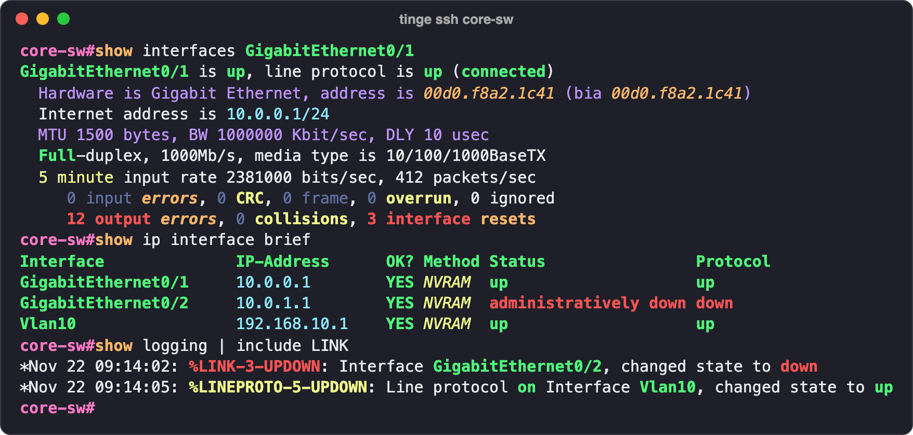
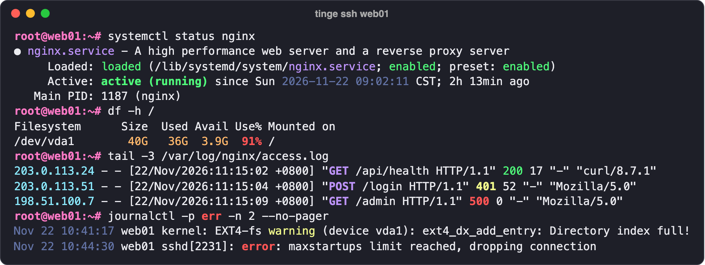

# tinge

English | [简体中文](README.zh-CN.md)

Highlights terminal output with regex rules: wrap `ssh`, `telnet` or a serial console in it and interfaces, addresses, states and errors get colors. A single static binary with rules for network devices and Linux servers built in.




```sh
tinge ssh switch01           # run a program in a pseudo-terminal
tinge -t router ssh gw01     # the host's tags help choose the rules
tinge tio /dev/cu.usbserial  # anything interactive works: vim, less, top
show-logs | tinge            # or color a pipe
```

| Option | |
|---|---|
| `-c set` | Rule set by name, or a file path; without it, chosen by `match` (below) |
| `-t tags` | The host's tags, comma separated, for choosing the set |
| `--print-rules` | Print the set that would be used, its name on stderr |
| `-R` | 24-bit colors; default when `COLORTERM` is `truecolor` or `24bit`, else xterm-256 |
| `-r` | Reload the config of every running tinge (or send it `SIGUSR1`) |
| `-b` | Print time spent and matches per rule at exit |

The exit status is the program's (128 + n when a signal killed it, 127 when it is not found).

## Rules

Two sets are built in:

| Set | For | Colors |
|---|---|---|
| [`network`](rules/network.yml) | switches, routers, firewalls (Cisco, Huawei, H3C, Ruijie, Juniper); telnet and serial consoles | prompts, interfaces, addresses, link and protocol states, error counters, ACLs, routing, syslog levels |
| [`server`](rules/server.yml) | Linux / Unix shells, and anything else | prompts, comments, systemd states and units, errors and warnings, log levels and times, addresses, disk usage, sizes, ping loss, HTTP access logs |

Each set says what it is for in its `match` section. Without `-c`, tinge takes the first set, by name, where any pattern matches: `commands` against the program (`telnet`, `tio`), `hosts` against the host that ssh or telnet connects to, `tags` against `--tags`. Patterns are globs, case-insensitive. When none matches, the set with `default: true` is used.

```yaml
match:
  commands: [telnet, tio]
  hosts: ['*ruijie*', '*cisco*']
  tags: [switch, router, firewall]
```

Your sets go in `~/.config/tinge/` (under `$XDG_CONFIG_HOME`): `lab.yml` is a set named `lab`, chosen by its own `match`, and a file named like a built-in set replaces it. To start from a built-in one: `tinge -c server --print-rules > ~/.config/tinge/server.yml`. The format:

```yaml
palette:
  green: "#50fa7b"
rules:
  - description: Interface
    regex: '\b(Gi|Te)\S+'
    color: f.green bold
    exclusive: true          # later rules may not color inside its matches
  - regex: 'line protocol is (up|down)'
    color:
      1: b#ff5555 underline  # a color per group, by number or name
```

A color is any of `f#rrggbb`, `b#rrggbb`, `f.name` / `b.name` from the palette, and `blink bold invert italic strike underline`. Regexes are Python `re` patterns matched against bytes, including lookbehind (fixed width, as in Python) and named groups.

## How it works

Output is split on new lines and control sequences, and each piece is highlighted on its own. A line cut across reads waits briefly for the rest, single typed characters (echo) are left alone, and colors the program printed itself are kept and restored around the rule colors. The algorithm is a port of [ChromaTerm](https://github.com/rgcr/ChromaTerm2)'s.

Regexes run on [PCRE2](https://github.com/PCRE2Project/pcre2) with its JIT, in byte mode without Unicode, so `\d \w \s \b` stay ASCII-only like Python bytes patterns and positions are byte offsets. When a read holds many lines (`show running-config`), their matches are found in parallel; output order and colors don't change.

## Build

```sh
cargo build --release    # target/release/tinge; the version comes from Cargo.toml
```

## Test

```sh
cargo clippy --all-targets -- -D warnings && cargo test   # everything, as CI runs it
cargo test select                                         # which set a program, host or tag gets
cargo test --test snapshot                                # the built-in sets' output
cargo bench                                               # highlighting speed
```

| File | Covers |
|---|---|
| `tests/cli.rs` | the binary in a pseudo-terminal: output, exit status, Ctrl-C, window size and resizing, input; pipe mode, a closed pipe, reloading, usage |
| `src/main.rs`, `src/rules.rs`, `src/select.rs` | options; rule set lookup and choice; globs |
| `src/highlight/` | Python regex semantics, config errors, colors, existing colors, exclusive rules |
| `src/stream.rs` | splitting output, waiting for the rest of a line, echo, control strings, typing |
| `tests/snapshot.rs` | the snapshots below |

Every built-in set's output for `testdata/corpus.bin` is pinned in `testdata/expected-<set>-*.bin`. After changing a set on purpose, rewrite them and review the diff:

```sh
UPDATE=1 cargo test --test snapshot
git diff --stat testdata
```

To add lines to the corpus, edit `testdata/corpus.py`, then run `uv run --no-project python testdata/corpus.py` and the update above.

Output that a program prints just before it exits is easy to lose under load. To check, keep every CPU busy and run the pseudo-terminal tests many times:

```sh
for i in $(seq $(sysctl -n hw.ncpu 2>/dev/null || nproc)); do yes >/dev/null & done
for i in $(seq 200); do cargo test -q --test cli || break; done; kill $(jobs -p)
```

By hand:

```sh
tinge --print-rules ssh switch01 >/dev/null          # stderr names the set it would use
tinge -t router --print-rules ssh 10.0.0.1 >/dev/null
printf 'Active: active (running)\n' | tinge -c server # try a set on sample text
tinge -b ssh switch01                                # at exit: matches and time per rule
```

## License

MIT, including ChromaTerm's copyright notices; see [LICENSE](LICENSE).
