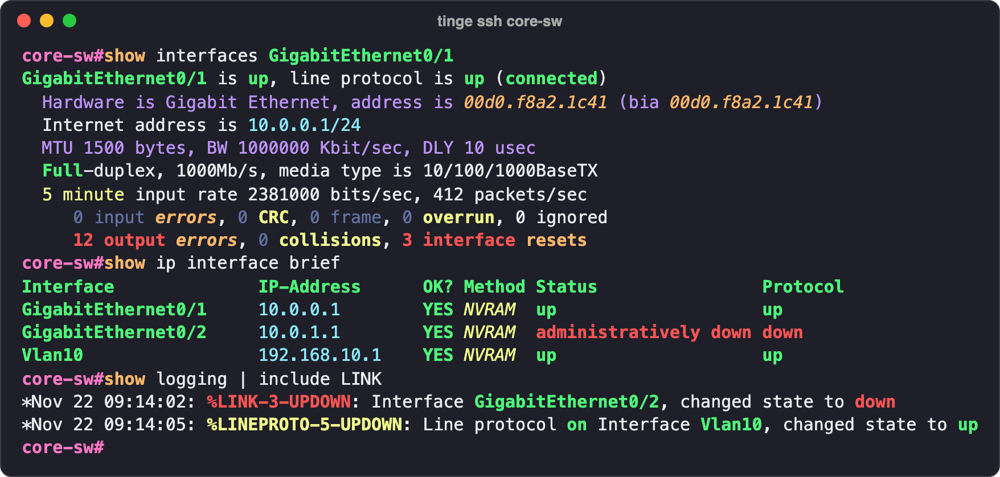
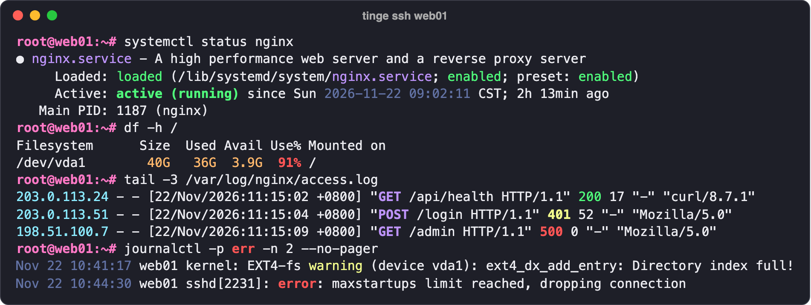

# tinge

[English](README.md) | 简体中文

用正则规则高亮终端输出：把 `ssh`、`telnet` 或串口控制台包在它里面，接口、地址、状态和错误就会带上颜色。单个静态二进制文件，内置网络设备和 Linux 服务器的规则。




```sh
tinge ssh switch01           # 在伪终端中运行程序
tinge -t router ssh gw01     # 主机的标签帮助选择规则
tinge tio /dev/cu.usbserial  # 任何交互程序都行：vim、less、top
show-logs | tinge            # 或者给管道上色
```

| 选项 | |
|---|---|
| `-c set` | 规则集名称或文件路径；不指定时按 `match` 选择（见下文） |
| `-t tags` | 主机的标签，逗号分隔，用于选择规则集 |
| `--print-rules` | 打印将要使用的规则集，名称输出到 stderr |
| `-R` | 24 位色；`COLORTERM` 为 `truecolor` 或 `24bit` 时默认开启，否则用 xterm-256 色 |
| `-r` | 让所有正在运行的 tinge 重新加载配置（或向它发送 `SIGUSR1`） |
| `-b` | 退出时打印每条规则的耗时和匹配次数 |

退出状态与所运行程序一致（被信号终止时为 128 + n，找不到程序时为 127）。

## 规则

内置两套规则集：

| 规则集 | 适用于 | 着色内容 |
|---|---|---|
| [`network`](rules/network.yml) | 交换机、路由器、防火墙（思科、华为、H3C、锐捷、Juniper）；telnet 和串口控制台 | 提示符、接口、地址、链路和协议状态、错误计数、ACL、路由、syslog 级别 |
| [`server`](rules/server.yml) | Linux / Unix shell，以及其他一切 | 提示符、注释、systemd 状态和单元、错误和警告、日志级别和时间、地址、磁盘用量、大小、ping 丢包、HTTP 访问日志 |

每套规则集在自己的 `match` 段中声明适用对象。不带 `-c` 时，tinge 按名称顺序取第一个有模式匹配的规则集：`commands` 匹配程序（`telnet`、`tio`），`hosts` 匹配 ssh 或 telnet 连接的主机，`tags` 匹配 `--tags`。模式为 glob，不区分大小写。都不匹配时使用 `default: true` 的规则集。

```yaml
match:
  commands: [telnet, tio]
  hosts: ['*ruijie*', '*cisco*']
  tags: [switch, router, firewall]
```

自定义规则集放在 `~/.config/tinge/`（遵循 `$XDG_CONFIG_HOME`）：`lab.yml` 就是名为 `lab` 的规则集，按它自己的 `match` 选择；与内置规则集同名的文件会替换内置的那套。想从内置规则集开始改：`tinge -c server --print-rules > ~/.config/tinge/server.yml`。格式如下：

```yaml
palette:
  green: "#50fa7b"
rules:
  - description: Interface
    regex: '\b(Gi|Te)\S+'
    color: f.green bold
    exclusive: true          # 后续规则不能在它匹配的范围内再上色
  - regex: 'line protocol is (up|down)'
    color:
      1: b#ff5555 underline  # 按分组编号或名称分别指定颜色
```

颜色可以是 `f#rrggbb`、`b#rrggbb`、调色板中的 `f.name` / `b.name`，以及 `blink bold invert italic strike underline`。正则是匹配字节的 Python `re` 模式，支持后行断言（与 Python 一样须定长）和命名分组。

## 工作原理

输出按换行和控制序列切分，每一段单独高亮。被多次读取截断的行会稍等剩下的部分；单个键入字符（回显）不处理；程序自己输出的颜色会被保留，并在规则颜色前后恢复。算法移植自 [ChromaTerm](https://github.com/rgcr/ChromaTerm2)。

正则引擎是带 JIT 的 [PCRE2](https://github.com/PCRE2Project/pcre2)，以不带 Unicode 的字节模式运行，因此 `\d \w \s \b` 与 Python 字节模式一样只匹配 ASCII，位置是字节偏移。一次读取包含很多行时（`show running-config`），各行的匹配并行进行；输出顺序和颜色不受影响。

## 构建

```sh
cargo build --release    # 生成 target/release/tinge；版本号取自 Cargo.toml
```

## 测试

```sh
cargo clippy --all-targets -- -D warnings && cargo test   # 全部测试，与 CI 相同
cargo test select                                         # 程序、主机或标签会选中哪套规则
cargo test --test snapshot                                # 内置规则集的输出
cargo bench                                               # 高亮速度
```

| 文件 | 覆盖内容 |
|---|---|
| `tests/cli.rs` | 伪终端中的二进制：输出、退出状态、Ctrl-C、窗口大小及调整、输入；管道模式、管道被关闭、重新加载、用法 |
| `src/main.rs`、`src/rules.rs`、`src/select.rs` | 选项；规则集查找和选择；通配符 |
| `src/highlight/` | Python 正则语义、配置错误、颜色、已有颜色、exclusive 规则 |
| `src/stream.rs` | 输出切分、等待行的剩余部分、回显、控制字符串、键入 |
| `tests/snapshot.rs` | 下面的快照 |

每套内置规则集对 `testdata/corpus.bin` 的输出都固定在 `testdata/expected-<set>-*.bin` 中。有意修改规则集后，重新生成并检查差异：

```sh
UPDATE=1 cargo test --test snapshot
git diff --stat testdata
```

要往语料里加行，编辑 `testdata/corpus.py`，然后运行 `uv run --no-project python testdata/corpus.py`，再执行上面的更新步骤。

程序退出前最后打印的输出在高负载下容易丢失。要检查这一点，让所有 CPU 满载，多次运行伪终端测试：

```sh
for i in $(seq $(sysctl -n hw.ncpu 2>/dev/null || nproc)); do yes >/dev/null & done
for i in $(seq 200); do cargo test -q --test cli || break; done; kill $(jobs -p)
```

手动检查：

```sh
tinge --print-rules ssh switch01 >/dev/null          # stderr 显示会用哪套规则
tinge -t router --print-rules ssh 10.0.0.1 >/dev/null
printf 'Active: active (running)\n' | tinge -c server # 用示例文本试一套规则
tinge -b ssh switch01                                # 退出时：每条规则的匹配数和耗时
```

## 许可证

MIT，包含 ChromaTerm 的版权声明；见 [LICENSE](LICENSE)。
